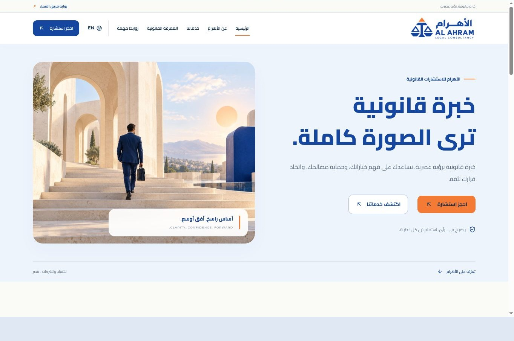
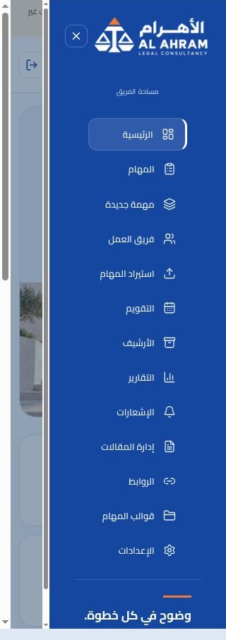
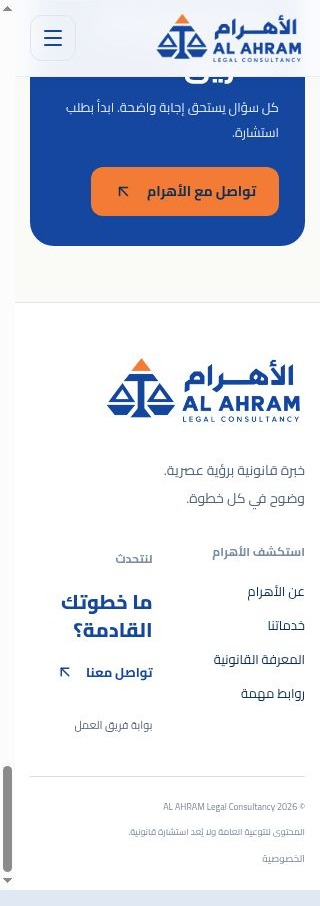
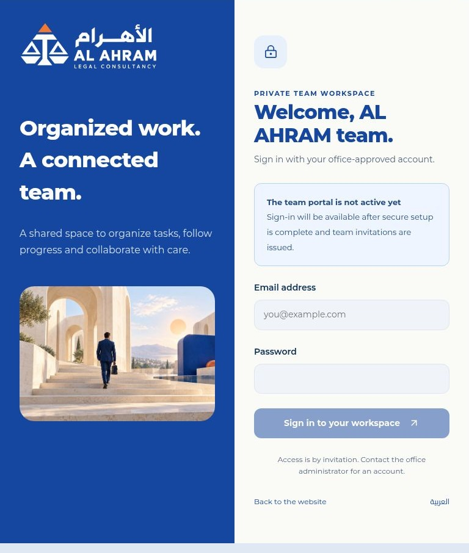

# مراجعة الشعار المؤقت — 2026-10-25

هذه لقطات فعلية من المعاينة المحلية بعد إدراج PNG المرفق دون تعديل. لقطات لوحة الفريق من مكونات React الفعلية ببيانات اصطناعية وإجراءات غير متصلة، وليست جلسات Supabase حقيقية. لقطات تسجيل الدخول تعكس بوابة Sites غير المفعلة الحالية.

24 حالة = العربية/الإنجليزية × 320/768/1440 × الهيدر/الفوتر/الدخول/القائمة الجانبية. كل الملفات محملة، والنسب مطابقة للأصل، ولا يوجد تجاوز أفقي على جذر الصفحة. عرض المحتوى قد ينقص 15px بسبب شريط التمرير. لقطة 1440 معروضة بتصغير متناسب في المتصفح لتناسب نافذة التصوير؛ القياسات مأخوذة من مساحة محتوى iframe ذات العرض المطلوب. أزيل شريط أدوات المراجعة والفراغ الجانبي فقط من ملفات الصور.

| اللغة | العرض المطلوب | الهيدر | الفوتر | الدخول | القائمة |
|---|---|---|---|---|---|
| ar | 320 | [PASS](screenshots/header-ar-320.jpg) | [PASS](screenshots/footer-ar-320.jpg) | [PASS](screenshots/login-ar-320.jpg) | [PASS](screenshots/sidebar-ar-320.jpg) |
| ar | 768 | [PASS](screenshots/header-ar-768.jpg) | [PASS](screenshots/footer-ar-768.jpg) | [PASS](screenshots/login-ar-768.jpg) | [PASS](screenshots/sidebar-ar-768.jpg) |
| ar | 1440 | [PASS](screenshots/header-ar-1440.jpg) | [PASS](screenshots/footer-ar-1440.jpg) | [PASS](screenshots/login-ar-1440.jpg) | [PASS](screenshots/sidebar-ar-1440.jpg) |
| en | 320 | [PASS](screenshots/header-en-320.jpg) | [PASS](screenshots/footer-en-320.jpg) | [PASS](screenshots/login-en-320.jpg) | [PASS](screenshots/sidebar-en-320.jpg) |
| en | 768 | [PASS](screenshots/header-en-768.jpg) | [PASS](screenshots/footer-en-768.jpg) | [PASS](screenshots/login-en-768.jpg) | [PASS](screenshots/sidebar-en-768.jpg) |
| en | 1440 | [PASS](screenshots/header-en-1440.jpg) | [PASS](screenshots/footer-en-1440.jpg) | [PASS](screenshots/login-en-1440.jpg) | [PASS](screenshots/sidebar-en-1440.jpg) |

## أمثلة فعلية

